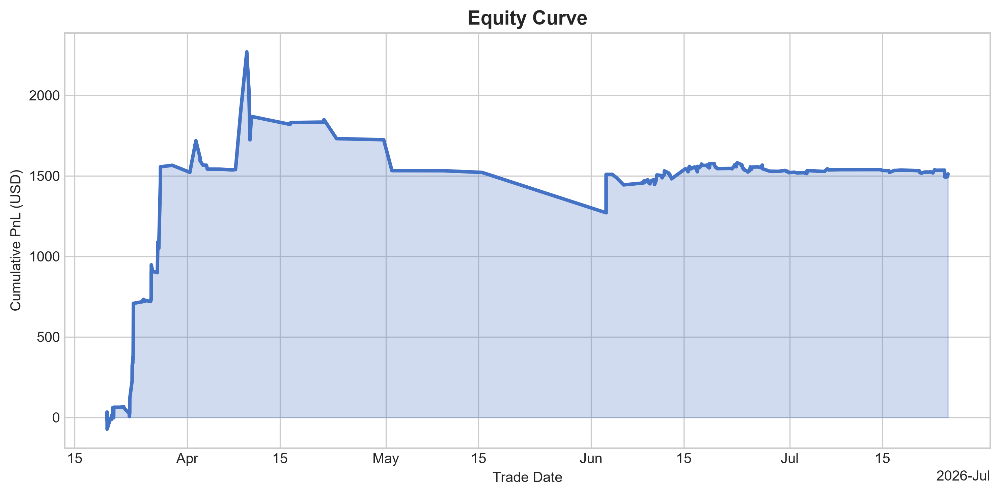
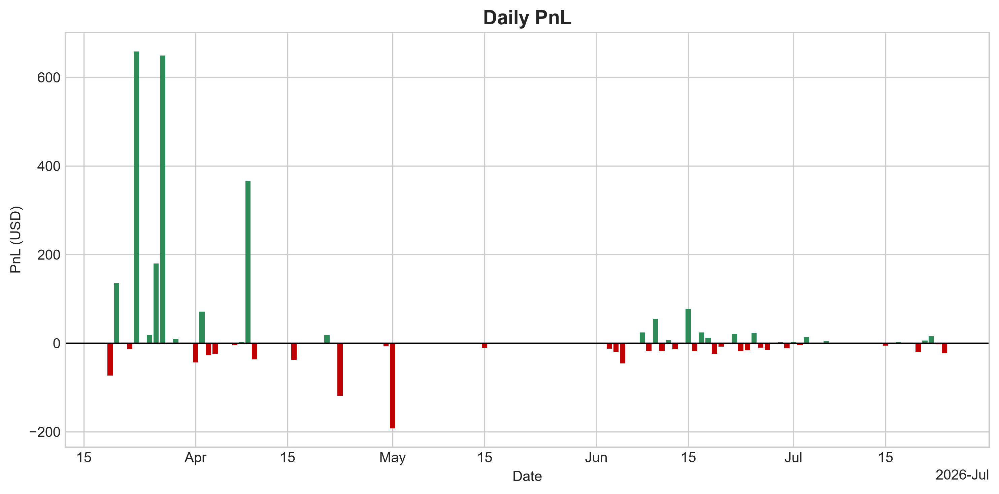
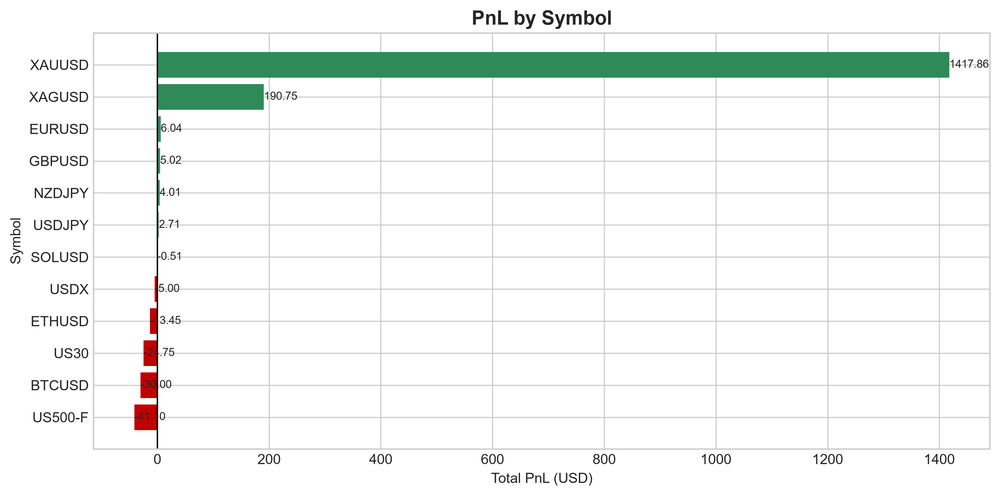

# Trading Journal Analytics System

Trading Journal Analytics System is an end-to-end Python ETL and analytics project for cTrader trading statement exports.

The system extracts and cleans raw trading data, loads it into a SQL database (SQLite or PostgreSQL), performs SQL-based performance analytics, generates CSV reports, visualizations, and dashboards (Excel and Power BI), and validates data integrity through automated testing.

> **Sample data note:** This repo ships with a demo cTrader statement (`data/raw/statement-08_07demo.csv`) so the full pipeline can be run end to end by anyone who clones it. My real trading history is excluded for privacy — the analysis approach and SQL logic are identical either way.

---

# Project Overview

This project was built to practice and demonstrate:

- Python automation
- CSV data processing
- Data cleaning with pandas
- SQL database loading (SQLite or PostgreSQL)
- SQL-based analytics (CTEs, aggregations, window functions)
- Data validation
- Automated testing with pytest
- Chart generation with matplotlib
- Dashboard generation (Excel via openpyxl, Power BI via DAX)
- Command-line driven ETL and analytics pipelines

---

# Architecture

```text
cTrader Statement CSV
          ↓
       Ingest
          ↓
        Clean
          ↓
      Validate
          ↓
   SQLite / PostgreSQL
          ↓
    SQL Analytics
          ↓
     CSV Reports
          ↓
 Charts + Dashboards
```

---

# Supported Input Format

Currently supported:

- ✅ cTrader Statement Export CSV

Planned:

- 🔜 MetaTrader 4 (MT4)
- 🔜 MetaTrader 5 (MT5)
- 🔜 DXtrade

---

# Installation

## Create Virtual Environment

```bash
python -m venv .venv
```

## Activate Virtual Environment

### Windows

```bash
.venv\Scripts\activate
```

### Linux / macOS

```bash
source .venv/bin/activate
```

## Install Dependencies

```bash
pip install -r requirements.txt
```

## Configure the Database (optional)

By default the app uses a local SQLite file. To use PostgreSQL instead, copy `.env.example` to `.env` and set `DATABASE_URL`:

```bash
cp .env.example .env
```

```text
# .env
DATABASE_URL=postgresql+psycopg2://<user>:<password>@localhost:5432/trading_journal
```

Leave `DATABASE_URL` empty (or omit `.env` entirely) to use SQLite.

---

# Tech Stack

- Python
- pandas
- SQLite / PostgreSQL
- SQLAlchemy
- SQL (CTEs, window functions, aggregations)
- matplotlib
- openpyxl
- Power BI / DAX
- pytest

---

# Project Structure

```text
.
├── charts/
│   ├── equity_curve.png
│   ├── daily_pnl.png
│   ├── pnl_by_symbol.png
│   └── ...
│
├── v1-dashboard_excel/
│   └── trading_dashboard.xlsx
│
├── v2-dashboard_powerbi/
│   └── trading_dashboard_v2.pbix
│
├── data/
│   ├── raw/
│   │   └── statement-08_07demo.csv
│   │
│   └── processed/
│       ├── deals_raw.csv
│       ├── transactions_raw.csv
│       ├── deals_clean.csv
│       └── transactions_clean.csv
│
├── output/
│   ├── avg_win_loss.csv
│   ├── best_worst_trade.csv
│   ├── daily_pnl.csv
│   ├── pnl_by_symbol.csv
│   ├── profit_factor.csv
│   ├── total_pnl.csv
│   ├── trade_counts.csv
│   ├── win_rate.csv
│   └── ...
│
├── sql/
│   ├── sqlite/
│   │   ├── avg_win_loss.sql
│   │   ├── win_rate.sql
│   │   └── ...
│   │
│   └── postgres/
│       ├── avg_win_loss.sql
│       ├── win_rate.sql
│       └── ...
│
├── src/
│   ├── ingest.py
│   ├── clean.py
│   ├── validate.py
│   ├── db.py
│   ├── analysis.py
│   ├── chart_generation.py
│   └── sql_to_excel_dashboard.py
│
├── scripts/
│   └── kpi_summary.py
│   └── check_csv.py
│   └── check_db.py
│   └── setup_db.py
│
├── settings/
│   ├── config.py
│   └── paths.py
│
├── tests/
│   └── test_validation.py
│
├── main.py
├── .env
├── requirements.txt
└── README.md
```

---

# Features

## 1. Raw CSV Ingestion

The ingestion step reads a raw cTrader statement export and separates the file into:

- Deals data
- Transactions data

The extracted sections are saved as:

```text
data/processed/deals_raw.csv
data/processed/transactions_raw.csv
```

---

## 2. Data Cleaning

The cleaning stage prepares raw data for analysis by:

- Removing fully empty rows
- Cleaning column names
- Converting date columns
- Extracting numeric lot sizes
- Converting PnL and balance columns to numeric values
- Classifying rows as trade or summary
- Renaming columns into analysis-friendly names

Cleaned outputs are stored as:

```text
data/processed/deals_clean.csv
data/processed/transactions_clean.csv
```

---

## 3. Data Validation

The validation stage checks:

- Total row counts
- Missing values
- Duplicate rows
- Trade row completeness
- Trade vs summary row classification

This helps ensure analytics are generated only from valid data.

---

## 4. Database Loading (SQLite / PostgreSQL)

Cleaned CSV files are loaded into `deals` and `transactions` tables in whichever database `DATABASE_URL` resolves to:

- No `DATABASE_URL` set → local SQLite file (`trading_journal.db`)
- `DATABASE_URL` set → PostgreSQL

Tables are loaded using:

```python
if_exists="replace"
```

which refreshes data on every pipeline execution.

---

## 5. SQL Analytics

The project uses standalone SQL files for each performance metric, with a matching version for SQLite (`sql/sqlite/`) and PostgreSQL (`sql/postgres/`).

Generated analytics include:

- Total PnL
- Trade Counts
- Win Rate
- Profit Factor
- Average Win / Average Loss
- Best Trade / Worst Trade
- Daily PnL / Monthly PnL
- PnL by Symbol
- Session Analysis / Weekday Analysis
- Drawdown Analysis
- Equity Curve
- Longest Winning Streak
- Monthly Rank (window functions)
- Time-of-Day Analysis

All analytics exclude summary rows through:

```sql
WHERE row_type = 'trade'
```

to prevent inaccurate calculations.

---

## 6. Output CSV Reports

SQL query results are exported into the output folder.

Examples:

```text
output/total_pnl.csv
output/win_rate.csv
output/profit_factor.csv
output/trade_counts.csv
output/daily_pnl.csv
output/pnl_by_symbol.csv
```

---

## 7. Chart Generation

The project generates visual trading performance reports using matplotlib.

Generated charts include:

```text
charts/equity_curve.png
charts/drawdown.png
charts/daily_pnl.png
charts/monthly_pnl.png
charts/pnl_by_symbol.png
charts/session_analysis.png
charts/weekday_analysis.png
```

### Equity Curve

Displays cumulative trading performance over time.

### Drawdown Analysis

Displays account equity drawdowns.

### Daily PnL

Shows daily profit and loss performance.

### Monthly PnL

Displays monthly profitability trends.

### PnL by Symbol

Shows total profitability by trading instrument.

### Session Analysis

Breaks down performance by market session.

### Weekday Analysis

Shows profitability by day of week.

---

# Dashboards

## Excel Dashboard (v1)

```text
v1-dashboard_excel/trading_dashboard.xlsx
```

Includes KPI summaries, analytics tables, embedded charts, and trading performance metrics — generated automatically from the SQL output tables.

## Power BI Dashboard (v2) — in progress

```text
v2-dashboard_powerbi/trading_dashboard_v2.pbix
```

An interactive report connected to PostgreSQL, with DAX measures (Total PnL, Win Rate, Profit Factor, Running Equity) and slicers for symbol and date. Currently covers the headline KPIs and equity/symbol breakdown; expanding to match the full metric set in the Excel dashboard (drawdown, session/weekday analysis, streaks) is in progress.

---

# Automated Testing

The project uses pytest to validate critical outputs.

Current tests verify:

- Database trade count matches cleaned CSV trade count
- Database total PnL matches cleaned CSV total PnL
- Trade counts match PnL signs
- Core SQL files filter only trade rows
- Win rate matches cleaned trade rows
- Profit factor matches cleaned trade rows
- Generated chart files exist and are not empty

Run tests:

```bash
pytest -v
```

Note: tests read from `data/processed/` and `output/`, so run `python main.py --mode full --file data/raw/statement-08_07demo.csv` at least once before testing on a fresh clone.

---

# How To Run

## Run Full Pipeline

```bash
python main.py --mode full --file data/raw/statement-08_07demo.csv
```

Runs:

```text
ETL
Analysis
Chart Generation
Dashboard Generation
```

---

## Run ETL Only

```bash
python main.py --mode etl --file data/raw/statement-08_07demo.csv
```

---

## Run Analysis Only

```bash
python main.py --mode analysis
```

---

## Run Charts Only

```bash
python main.py --mode chart
```

---

## Run Dashboard Only

```bash
python main.py --mode dashboard
```

---

## Run Tests

```bash
pytest -v
```

---

## Alternative

Simply run:

```bash
python main.py
```

If no file is supplied, the application will prompt you to select a cTrader statement CSV using a file picker (requires a desktop environment with Tkinter available).

---

# Pipeline Modes

| Mode | Description |
|--------|--------|
| etl | Ingests, cleans, validates, and loads data into the database |
| analysis | Runs SQL analytics and creates output CSV files |
| chart | Generates chart visualizations |
| dashboard | Creates the Excel dashboard |
| full | Runs the complete pipeline |

---

# Key Outputs

## CSV Reports

```text
output/total_pnl.csv
output/win_rate.csv
output/profit_factor.csv
output/trade_counts.csv
output/daily_pnl.csv
output/monthly_pnl.csv
output/pnl_by_symbol.csv
```

## Charts

```text
charts/equity_curve.png
charts/drawdown.png
charts/daily_pnl.png
charts/monthly_pnl.png
charts/pnl_by_symbol.png
charts/session_analysis.png
charts/weekday_analysis.png
```

## Dashboards

```text
v1-dashboard_excel/trading_dashboard.xlsx
v2-dashboard_powerbi/trading_dashboard_v2.pbix
```

---

# Screenshots

*(All generated from the demo dataset above — see the sample data note.)*

### Equity Curve



### Daily PnL



### PnL by Symbol



---

# Skills Demonstrated

- Python ETL Development
- Data Cleaning with Pandas
- Relational Database Design (SQLite & PostgreSQL)
- SQL Query Development (CTEs, window functions, aggregations)
- Data Validation
- Automated Testing with Pytest
- Data Visualization with Matplotlib
- Dashboard Development (Excel & Power BI / DAX)
- Data Analytics Engineering
- Command-Line Application Development

---

# Current Project Status

## Completed

- Raw CSV ingestion
- Data cleaning
- Data validation
- SQLite + PostgreSQL loading
- SQL analytics (CTEs, window functions, aggregations)
- Output CSV generation
- Chart generation
- Excel dashboard generation
- Automated pytest testing
- Command-line file input
- Automatic CSV file picker support

---

## Planned Improvements

- Finish the Power BI (v2) report to match the full metric set in the Excel dashboard
- Additional validation tests for analytics outputs
- Support for multiple broker export formats (MT4, MT5, DXtrade)
- Configuration file support

---

# Author

Personal Python ETL and SQL analytics project focused on transforming raw cTrader trading statements into actionable trading performance insights.
